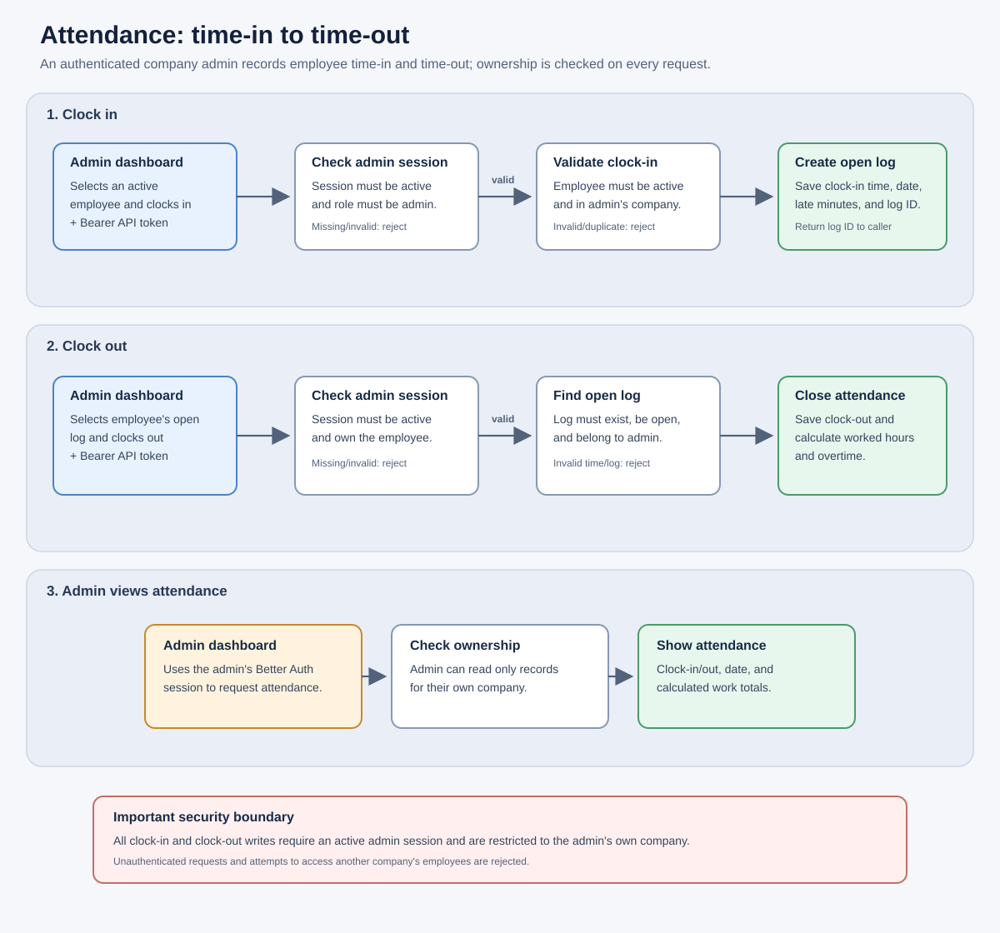

# Project Configuration

This document describes the runtime, deployment, database, authentication, and seed configuration for the backend in this repository.

## Requirements

- Bun (the current project environment uses Bun 1.4.x)
- Cloudflare Wrangler CLI, installed through the project dependencies
- Access to the Cloudflare account containing the configured D1 database for remote commands

Install dependencies from the repository root:

```bash
bun install
```

Run all commands below from the repository root, not from `controllers/`.

## Package Scripts

The scripts are declared in `package.json`:

| Command | Purpose |
|---|---|
| `bun run dev` | Start the Worker locally with Wrangler. |
| `bun run build` | Run `wrangler deploy --dry-run` to validate and build without deploying. |
| `bun run deploy` | Deploy the Worker and configured static assets to Cloudflare. |
| `bun run typecheck` | Run the `bun check` TypeScript check. |
| `bun run seed` | Apply pending migrations to local D1 and add 1,000 new product keys. |
| `bun run seed --remote` | Apply pending migrations to remote D1 and add 1,000 new product keys. |
| `bunx drizzle-kit generate --name <name>` | Generate a migration from schema changes. |
| `bunx drizzle-kit check` | Check the Drizzle migration history. |

Each ordinary seed invocation adds a new batch of 1,000 keys. It reads existing selectors and generates non-colliding selectors; it does not treat 1,000 as a maximum database total. The three-character alphanumeric selector allows at most 46,656 unique keys. Generated plaintext key values are saved in a `seeded-keys-*.txt` file in the current directory; these files are excluded from Git by `.gitignore`.

To restore the plaintext values from an existing key export into matching database records:

```bash
bun run seed --import-existing ./seeded-keys-<id>.txt --remote
```

Keep key exports private. The database currently stores both the plaintext key value (for the admin testing dashboard) and a bcrypt hash (for verification).

## Cloudflare Worker and D1

Cloudflare settings are in `wrangler.jsonc`:

- `name`: Worker service name, `system-payroll-api`.
- `main`: Worker entry point, `main.ts`.
- `compatibility_date`: Cloudflare runtime compatibility date.
- `compatibility_flags`: enables `nodejs_compat`.
- `assets.directory`: static public files come from `public/`.
- `assets.run_worker_first`: API and admin paths are handled by the Worker before static asset fallback.
- `d1_databases`: binds the D1 database to the Worker as `env.DB`. The configured database is named `system-payroll`; its ID and migration directory are in this file.

The Worker binding is typed as `D1Database` in `main.ts` and the controllers. Local Wrangler state is kept under `.wrangler/` and ignored by Git.

Apply database migrations:

```bash
# Local D1
bunx wrangler d1 migrations apply system-payroll --local

# Remote D1
bunx wrangler d1 migrations apply system-payroll --remote
```

Remote operations act on the configured production D1 database. Review the target before running commands that mutate it.

## Drizzle and Database Schema

`drizzle.config.ts` tells Drizzle Kit to:

- Read the schema from `schema/schema.js`.
- Write generated SQL migrations and metadata to `drizzle/`.
- Use the SQLite dialect (Cloudflare D1 is SQLite-compatible).

The schema defines Better Auth tables and application tables. Product-key related columns and relationships are:

- `key_product`: unique selector, plaintext key value, bcrypt hash, status, activation timestamp, and creation timestamp.
- `user_admin.key_product_id`: nullable unique foreign key to `key_product.id`, associating an administrator account with its redeemed key.
- Status lifecycle: `active` → `activated` → `registration_pending` → `redeemed`; keys may also be `revoked`.

Migration files are applied in journal order, recorded in `drizzle/meta/_journal.json`. Do not edit an already-applied migration to change a deployed database; create a new migration instead.

## Authentication

Authentication is configured in `auth.ts` using Better Auth with the Drizzle D1 adapter:

- User, session, account, and verification records use tables from `schema/schema.js`.
- Email/password authentication is enabled; passwords must be at least six characters.
- The `role` additional user field defaults to `employee` and is not accepted as a client-supplied field by Better Auth.
- The bearer plugin is enabled.
- Cookie `secure` and `sameSite` attributes are selected based on whether the request base URL uses HTTPS.
- Browser origins trusted by Better Auth are listed in `trustedOrigins`.

The Hono application in `main.ts` also has a CORS allowlist. When adding a browser frontend origin, update the appropriate allowlist(s) and verify that cookie credentials are allowed. The Worker exposes Better Auth handlers under `/api/auth/*`.

## Attendance Time-in and Time-out

Attendance clock-in and clock-out are controlled by an authenticated administrator session:



### Administrator endpoints

All attendance write endpoints require a valid Better Auth administrator session. Each write is restricted to employees in a company owned by that admin.

| Method and path | Request input | Purpose |
|---|---|---|
| `POST /api/attendance/admin/clock-in` | JSON: `{"employeeId":"...","companyId":"...","logDate":"YYYY-MM-DD","timeInMinutes":540,"shiftStartMinutes":480}` | Records an active employee's clock-in only if the admin owns the company. The standard shift starts at 08:00; an employee cannot have another open attendance record. |
| `PUT /api/attendance/admin/clock-out/:id` | JSON: `{"timeOutMinutes":1020,"breakMinutes":60}` | Closes an open attendance record only if it belongs to the admin's company. The standard break is 60 minutes and overtime is calculated after 8 worked hours. Overnight shifts are supported. |

Clock values are local minutes after midnight (0–1439). For example, 09:00 is `540` and 17:00 is `1020`. The desktop dashboard records time from the local system clock. Unauthenticated requests and machine-token writes are not accepted.

### Administrator read endpoints

These endpoints require an authenticated administrator session. Results are restricted to companies owned by that admin.

| Method and path | Request input | Purpose |
|---|---|---|
| `GET /api/attendance/company/:companyId` | Company ID in path | Lists attendance records for employees in the admin's company. |
| `GET /api/attendance/employee/:employeeId?date=YYYY-MM-DD` | Employee ID in path; optional `date` query | Lists one employee's attendance records, optionally filtered by date. |

## Static Test Dashboard

The backend serves `public/index.html` from the configured Cloudflare assets directory. API paths are routed through the Worker first. Deploy the Worker after changing the page or backend code:

```bash
bun run build
bun run deploy
```

The test dashboard requests product-key records using the administrator-protected list route. The page is public, but the records API requires an administrator session.

## Product-Key API

Base URL in production:

```text
https://system-payroll-api.automation-payroll.workers.dev
```

### Public routes

| Method and path | Request input | Purpose |
|---|---|---|
| `POST /api/key-products/verify` | JSON: `{"key":"abc-def-123"}` | Checks that the key is valid and still `active`; does not change it. |
| `POST /api/key-products/activate` | JSON: `{"key":"abc-def-123"}` | Changes a valid key from `active` to `activated`. A repeat activation returns `409 Conflict`. |
| `POST /api/key-products/register-admin` | JSON: `{"key":"abc-def-123","name":"Admin Name","email":"admin@example.com","password":"at-least-6-characters"}` | Creates an administrator account from an activated key, links the key to `user_admin`, and marks it `redeemed`. The key cannot be reused. |

Activation and admin registration are separate operations. The frontend should retain the entered key between activation and registration and include it in the registration request.

### Administrator-only routes

These routes require an authenticated administrator session:

| Method and path | Request input | Purpose |
|---|---|---|
| `POST /api/key-products` | No body | Creates a product key. The response includes the generated key once. |
| `GET /api/key-products?limit=1000` | Optional query `limit`, integer from 1 to 1,000 | Lists product-key records, including plaintext values for the test dashboard. |
| `DELETE /api/key-products/:id` | `id` path parameter | Changes the key status to `revoked`. |

### Account registration routes

- `POST /api/key-products/register-admin` is the product-key-authorized public admin registration route. Required JSON fields: `key`, `name`, `email`, and `password`.
- `POST /admin` is the existing employee registration route. It does not create administrators; administrator registration must use the product-key route.
- Better Auth endpoints are mounted under `/api/auth/*`; for example, email sign-in is `POST /api/auth/sign-in/email`.

## TypeScript

TypeScript options are in `tsconfig.json`. The project uses strict checking, bundler module resolution, ESNext target/libraries, Bun types, JavaScript imports, and `noEmit`.

Run:

```bash
bun check
```

The Worker dry-run build is the deployment-oriented validation:

```bash
bun run build
```

## Git and Local Files

`.gitignore` excludes dependencies, environment files, Wrangler local state, local databases/logs, build output, and `seeded-keys-*.txt` exports. Seed exports contain usable credentials; do not force-add them to Git.
