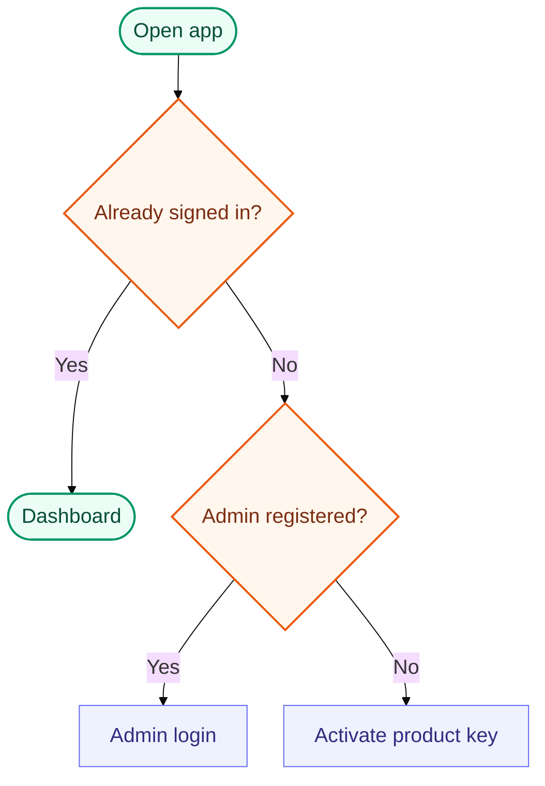
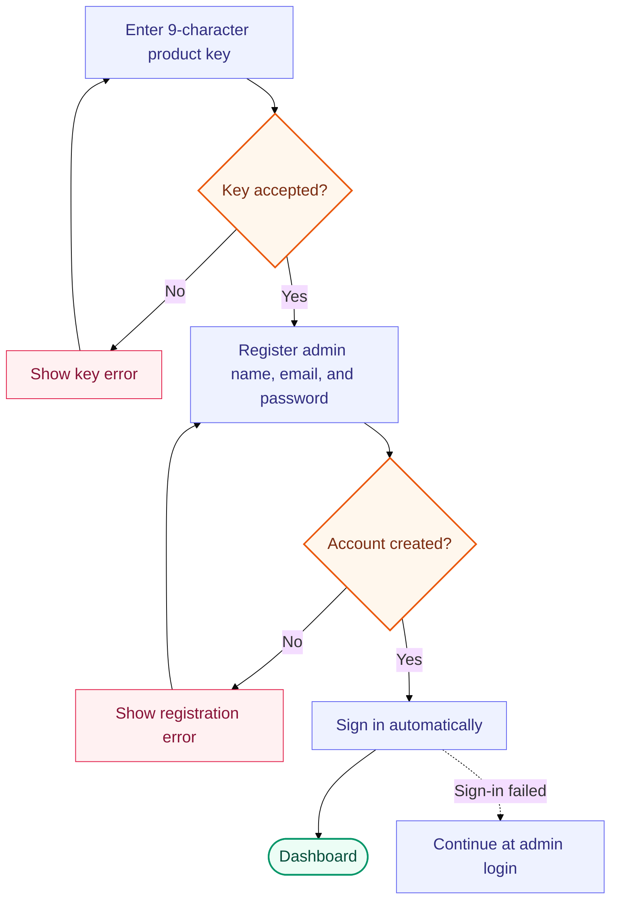
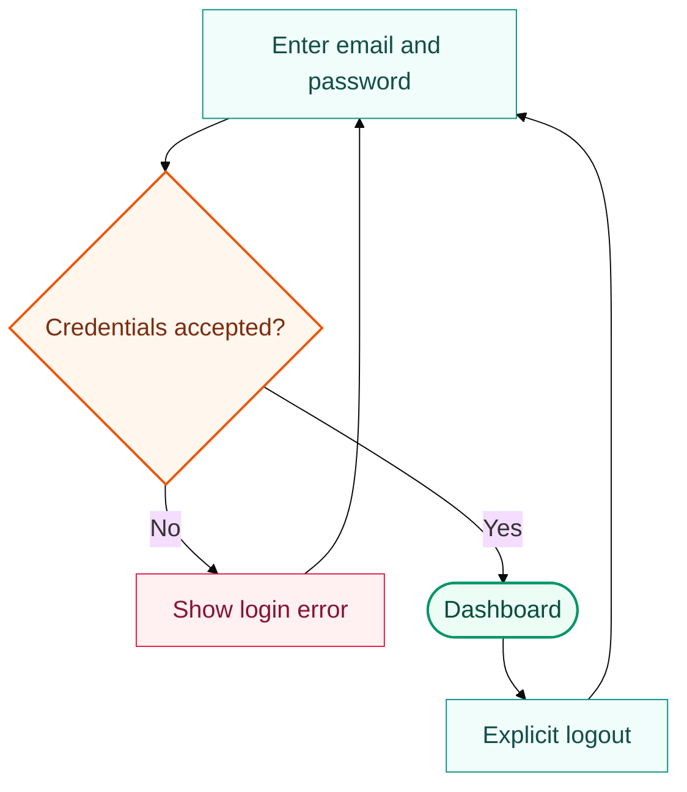

# Product Key & Admin Access

## App startup

## First-time admin setup

## Returning admin

Product-key activation is for the initial admin setup only. Returning admins
use `/login`; the **Stay logged in** setting controls the `rememberMe` value
sent during sign-in.
